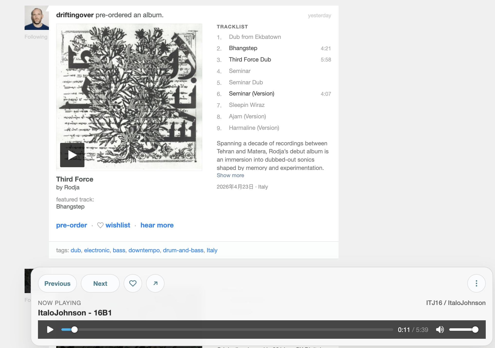

<div align="center">
  
  <h1 align="center">Bandcamplifier</h1>
  <p>
    <a href="https://chromewebstore.google.com/detail/bandcamplifer/ohkoanfoenpenbeehajomlmjnekphbaa">Chrome Web Store</a>
    ·
    <a href="https://addons.mozilla.org/en-US/firefox/addon/bandcamplifier/">Firefox Add-ons</a>
    ·
    <a href="https://greasyfork.org/en/scripts/573187-bandcamplifier">Greasy Fork</a>
  </p>
</div>

Bandcamplifier is an open source userscript and browser extension that improves the Bandcamp feed with release metadata, track playback, wishlist actions, and purchase shortcuts. Made by [chuan](https://www.instagram.com/chuan_p/) with heavy use of Codex.



## Highlights

- Enriches feed cards with release metadata loaded from linked album or track pages
- Turns artist and label `/music` pages into an enhanced release feed
- Replaces the `supported by` column with a readable inline tracklist on compatible cards
- Lets you play tracks from the feed and keeps a persistent bottom player in sync
- Adds per-track `wish` actions in the inline tracklist
- Opens Bandcamp's native buy dialog from the feed without automating the final purchase step
- Merges adjacent duplicate `bought a track` cards for the same fan and release
- Extends your own collection and wishlist search to release tags, so searching `techno` finds records that only carry that tag (opt-in: enable "Tag search" in the player settings; it is off by default and builds the index in the background)
- Coexists with [Batchcamp](https://github.com/hyphmongo/batchcamp): its bulk-download controls are scoped to the grid view, so they never act on a grid nobody can see (see [Batchcamp coexistence](#batchcamp-coexistence))

## Batchcamp coexistence

Batchcamp injects a download checkbox into every item of Bandcamp's own collection grid, plus floating Select All / Download controls. The enhanced feed replaces that grid and moves it offscreen (with pointer events disabled), so those checkboxes are unreachable from the list view.

The whole fix is one scoped CSS rule: while the enhanced feed is showing, Batchcamp's floating controls are hidden.

```css
.bcampx-label-feed-page--enhanced #select-all,
.bcampx-label-feed-page--enhanced .bc-select-all-wrapper,
.bcampx-label-feed-page--enhanced .bc-download-wrapper,
.bcampx-label-feed-page--enhanced .bc-dropdown {
  display: none !important;
}
```

Showing Bandcamp's grid removes that class and Batchcamp is fully usable again, with whatever it had selected still selected. Its DOM, its store and its selection state are never touched, nothing is detected or polled, and the rule simply matches nothing when Batchcamp is not installed.

The trade-off is explicit: Batchcamp's bulk download lives in the grid view. Switch to the grid (top-right toggle) when you want it; while you are browsing the feed it stays out of the way.

## Project Layout

- [`src/userscript.meta.js`](./src/userscript.meta.js): userscript metadata block and the single source of truth for the version
- [`src/bcamplifier.core.js`](./src/bcamplifier.core.js): shared core logic and the fragment placeholders
- [`src/features/artist-music-feed.js`](./src/features/artist-music-feed.js): artist/label feed, fan collection feed and tag-aware search
- [`src/features/player.js`](./src/features/player.js): shared audio, playback routing, player shell and media session
- [`src/features/track-actions.js`](./src/features/track-actions.js): per-track wishlist/buy helper frame and its bridge
- [`src/data/release-data.js`](./src/data/release-data.js): release page parsing and cache
- [`src/data/tag-index.js`](./src/data/tag-index.js): local tag index for collection/wishlist search
- [`src/styles/`](./src/styles): CSS bundled into the generated userscript
- [`src/ui/`](./src/ui): UI fragments bundled into the generated userscript
- [`src/utils/`](./src/utils): shared helper fragments bundled into the generated userscript
- [`scripts/lib/`](./scripts/lib): shared fixture server and headless Chrome helpers for the tests
- [`bcamplifier.user.js`](./bcamplifier.user.js): generated release userscript
- [`bcamplifier.dev.user.js`](./bcamplifier.dev.user.js): local Tampermonkey dev loader
- [`manifest.chrome.json`](./manifest.chrome.json): Chrome extension manifest
- [`manifest.firefox.json`](./manifest.firefox.json): Firefox extension manifest
- [`extension.content.js`](./extension.content.js): extension adapter for the shared core
- [`extension.background.js`](./extension.background.js): extension background bridge
- [`scripts/`](./scripts): build and verification helpers

## Installation

### Userscript

Bandcamplifier ships as a Tampermonkey userscript through the public Bandcamplifier release you distribute. For local testing or self-hosting, build the repository release file [`bcamplifier.user.js`](./bcamplifier.user.js) from the split source files in [`src/`](./src).

The release userscript:

- keeps the full `@match` scope required by feed, album, and track helper flows
- no longer points to local `127.0.0.1` update metadata
- preserves Bandcamp-native `buy` support

Why the broad `@match` is still needed:

- the feed UI runs on `bandcamp.com`
- release pages run on `*.bandcamp.com`
- wishlist and buy helpers need to execute in the real Bandcamp release-page context

### Browser Extension

The extension build is currently the secondary distribution target built from the same shared core.

Build the browser-specific packages:

```sh
./scripts/build-extension.sh
```

This produces:

- `dist/bcamplifier-chrome.zip`
- `dist/bcamplifier-firefox.xpi`

Load locally:

- Chrome: open `chrome://extensions`, enable Developer mode, click `Load unpacked`, then select `dist/chrome-unpacked`
- Firefox: open `about:debugging#/runtime/this-firefox`, click `Load Temporary Add-on`, then select `dist/firefox/manifest.json` (generated by the build step above)

## Permissions And Behavior

The userscript uses:

- `GM_xmlhttpRequest`
- `GM_getValue`
- `GM_setValue`

It can:

- fetch Bandcamp release HTML to parse metadata
- fetch Bandcamp's collection/item and compact release JSON APIs to index release tags for search
- cache parsed release data and the tag index locally
- create hidden helper iframes for some authenticated per-track actions
- open a Bandcamp tab for `buy` and trigger Bandcamp's native purchase dialog there

It can affect Bandcamp account state only when the user explicitly clicks a control such as:

- per-track `wish`
- the bottom-player wishlist button

It does not auto-buy anything. The `buy` shortcut opens Bandcamp's own UI and leaves final confirmation to the user.

## Local Development

Use the dev loader during active work:

- [`bcamplifier.dev.user.js`](./bcamplifier.dev.user.js)

Build the single-file userscript after editing files in [`src/`](./src):

```sh
npm install
node scripts/build-userscript.mjs
```

The build uses [Terser](https://github.com/terser/terser) to minify the released userscript. Readable source lives in [`src/`](./src).

Start a local server from the repository root:

```sh
python3 -m http.server 8000 --bind 127.0.0.1
```

Then install the dev loader in Tampermonkey. It uses `@require` to pull the local working copy.

The dev loader:

- keeps its own local `@updateURL` and `@downloadURL`
- points `@require` at `http://127.0.0.1:8000/bcamplifier.user.js`
- matches the same Bandcamp page scope as the release script so helper flows still work during development

Recommended workflow:

1. Edit the split source files in [`src/`](./src).
2. Use `bcamplifier.dev.user.js` while iterating locally.
3. Rebuild `bcamplifier.user.js` before testing or packaging.
4. Bump `@version` in [`src/userscript.meta.js`](./src/userscript.meta.js) when you want Tampermonkey to detect a fresh release build.

## Validation

Run the core checks from the repository root:

```sh
node scripts/build-userscript.mjs
git diff --exit-code -- bcamplifier.user.js
for file in $(find src -name '*.js'); do node --check "$file"; done
node --check bcamplifier.user.js
node scripts/test-text-format.mjs
./scripts/check-extension-scope.sh
./scripts/build-extension.sh
./scripts/smoke-test-extension.sh
./scripts/smoke-test-firefox.sh
./scripts/test-feed-fixture.sh
./scripts/test-label-music-fixture.sh
./scripts/test-label-music-grid-to-list-fixture.sh
./scripts/test-buy-link-fixture.sh
./scripts/test-feed-description-url-fixture.sh
./scripts/test-helper-auth-fixture.sh
./scripts/test-fan-profile-fixture.sh
./scripts/test-own-collection-fixture.sh
./scripts/test-batchcamp-fixture.sh
./scripts/test-init-isolation-fixture.sh
```

The verification helpers are:

- [`scripts/check-extension-scope.sh`](./scripts/check-extension-scope.sh): locks extension scope to the intended Bandcamp URLs
- [`scripts/smoke-test-extension.sh`](./scripts/smoke-test-extension.sh): checks that the Chrome build loads without manifest-level errors
- [`scripts/smoke-test-firefox.sh`](./scripts/smoke-test-firefox.sh): installs the Firefox package temporarily and verifies the shared core against a local HTTPS fixture
- [`scripts/smoke-test-userscript.sh`](./scripts/smoke-test-userscript.sh): boots the built userscript against a local HTTPS fixture through Playwright
- [`scripts/test-feed-fixture.sh`](./scripts/test-feed-fixture.sh): serves a local fixture and verifies that the shared core injects enhancement UI
- [`scripts/test-label-music-fixture.sh`](./scripts/test-label-music-fixture.sh): verifies artist and label `/music` pages are converted into enhanced feed cards
- [`scripts/test-label-music-grid-to-list-fixture.sh`](./scripts/test-label-music-grid-to-list-fixture.sh): verifies switching an artist page from grid to list view keeps the enhanced feed intact
- [`scripts/test-buy-link-fixture.sh`](./scripts/test-buy-link-fixture.sh): verifies that a release titled like "FREE DOWNLOAD ..." does not get its title swallowed by the buy-button update
- [`scripts/test-feed-description-url-fixture.sh`](./scripts/test-feed-description-url-fixture.sh): verifies that a long url inside a release description wraps instead of widening the feed card
- [`scripts/test-helper-auth-fixture.sh`](./scripts/test-helper-auth-fixture.sh): verifies that a crafted `#bcampx-helper` release URL cannot drive an authenticated wishlist request
- [`scripts/test-fan-profile-fixture.sh`](./scripts/test-fan-profile-fixture.sh): verifies fan collection, wishlist, tag-aware search, and tab-switch behavior against a local fixture
- [`scripts/test-own-collection-fixture.sh`](./scripts/test-own-collection-fixture.sh): verifies that singles from the same album stay separate cards with their own download links on your own collection page, while other fans' collections still merge them
- [`scripts/test-batchcamp-fixture.sh`](./scripts/test-batchcamp-fixture.sh): verifies that Batchcamp's controls are hidden in the list view, become fully usable (checkboxes on screen, Select All visible) as soon as the grid is shown, work whichever extension installs first, and do not re-sync the feed when Batchcamp appends its checkboxes
- [`scripts/test-init-isolation-fixture.sh`](./scripts/test-init-isolation-fixture.sh): verifies that a failed feed build does not abort the player, card scanning, or observer setup for the rest of the page load
- [`scripts/test-text-format.mjs`](./scripts/test-text-format.mjs): verifies that date-only release dates keep their calendar day west of UTC, timestamps keep their instant, and impossible dates fall back to raw text

## Configuration

Edit the `CONFIG` object near the top of [`src/bcamplifier.core.js`](./src/bcamplifier.core.js) to tune behavior:

- `autoFetchOnVisible`
- `expandAfterAutoFetch`
- `cacheTtlMs`
- `trackCacheTtlMs`
- `maxReleaseCacheEntries`
- `maxTracks`
- `maxDescriptionLength`
- `autoExpandTracks`
- `enableTrackRowActions`
- `showCollectionCounts`
- `maxSupporterExactCount`
- `maxSupporterRefreshPages`

## Status And Tradeoffs

- The project relies on Bandcamp's current DOM and helper flows.
- `buy` support depends on Bandcamp keeping a native track-page purchase dialog in roughly the same shape.
- Some helper features require the broader `@match` scope and will not work if the script is limited to feed URLs only.
- Full logged-in Bandcamp interaction still needs manual browser verification before each release.

## Contributing

Contributions are welcome. Start with [`CONTRIBUTING.md`](./CONTRIBUTING.md) for development and pull request guidance.

## License

MIT. See [`LICENSE`](./LICENSE).
